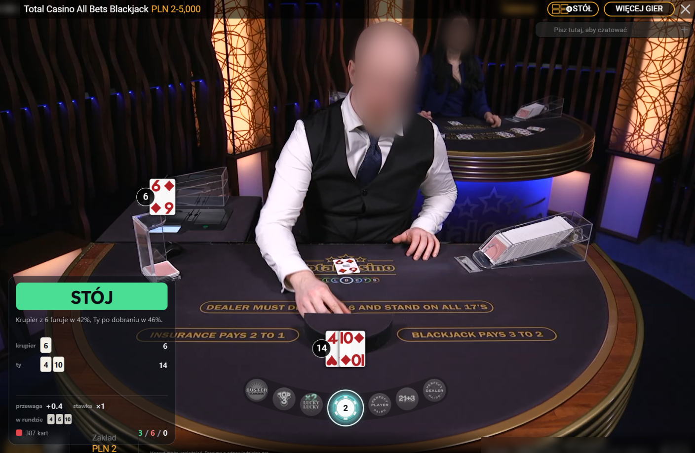
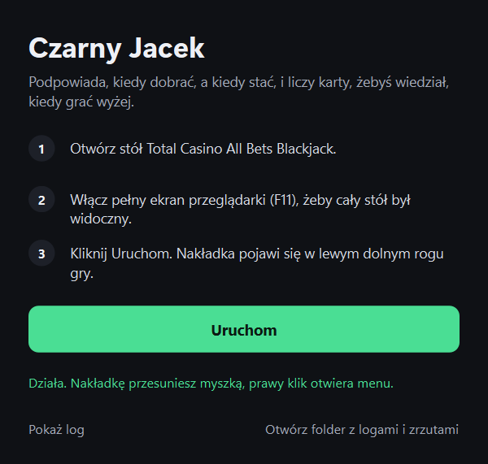
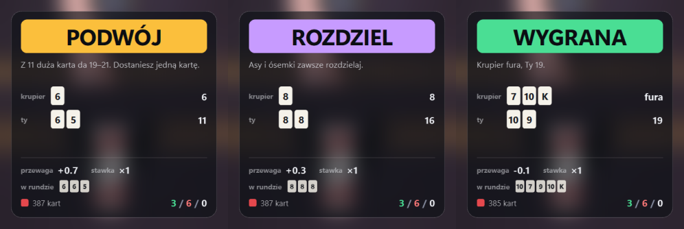
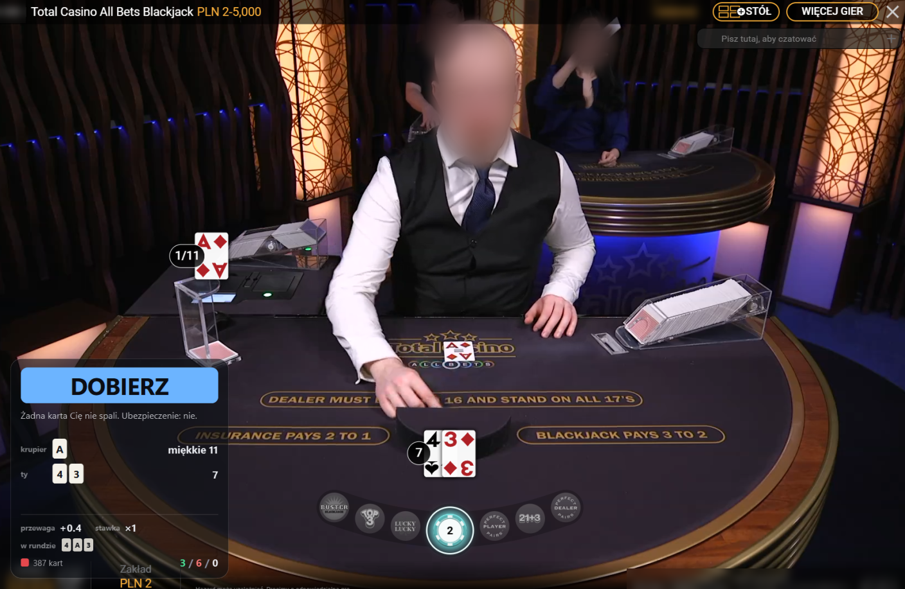
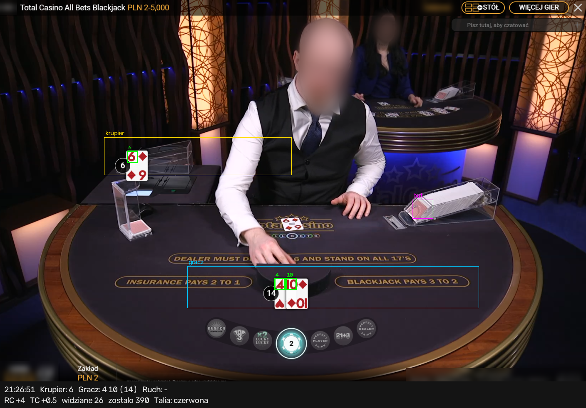

# Czarny Jacek

A small Windows overlay for **Total Casino All Bets Blackjack** (live dealer, in the browser).
It reads the cards from your screen, counts them, and tells you the best move with one line of why.

**[Download CzarnyJacek.exe](https://github.com/hkn-33/czarny-jacek/releases/latest/download/CzarnyJacek.exe)** · Windows 10/11 · no install, no Python · [all versions](https://github.com/hkn-33/czarny-jacek/releases)



*You hold 4 + 10 against the dealer's 6. The overlay says **STÓJ** (stand) and why: the dealer busts in 42% of hands from a 6, you would bust in 46% by hitting.*

## Get started

1. Open the **Total Casino All Bets Blackjack** table and press **F11** so the whole table is visible.
2. Run `CzarnyJacek.exe` and click **Uruchom**.
3. The overlay appears in the game's bottom-left corner. Drag it anywhere; right-click it for *new shoe* and *close*.

Windows may warn about an unknown publisher the first time: *More info → Run anyway*.



## Reading the overlay

| Part | What it tells you |
|---|---|
| Colored band | The move: **DOBIERZ** hit, **STÓJ** stand, **PODWÓJ** double, **ROZDZIEL** split. After the round: **WYGRANA**, **PRZEGRANA**, **REMIS**. |
| Line under it | Why this move, in one sentence. Mentions insurance when the dealer shows an ace. |
| krupier / ty | The dealer's cards and yours, with the total. After a split, one row per hand. |
| przewaga | The true count. From +1 up the shoe favours you; below 0 it favours the casino. `≈` means you joined mid-shoe, so it is understated. |
| stawka | How many minimum bets to put on the next round. Stays ×1 until the count is in your favour. |
| w rundzie | Every card counted this round, in order. Compare it with the table to trust the count. |
| ■ 387 kart | The shoe's card-back color and how many cards are left. **NOWY BUT** flags a new shoe; the count restarts. |
| 3 / 6 / 0 | Today's wins / losses / pushes, played exactly as advised. |



Once the overlay says **STÓJ**, it stays with that, even if other All Bets players keep hitting or split the shared hand. The result is scored on the hand you would have kept.



## How it works

1. **Finds the game.** It looks for the felt text *BLACKJACK PAYS 3 TO 2* at any size, anywhere on any monitor, so it works in a window, in full screen, on 4K or with Windows scaling.
2. **Reads the cards.** Five times a second it matches every card index against templates. It ignores the dealer's shirt and other look-alikes by only reading where cards can lie.
3. **Catches cards the game hides.** In All Bets the game draws only your hand. Cards dealt to players still hitting after you stood are read from the dealer's felt by the camera, so the count stays complete. A card it is not sure about is skipped, never guessed.
4. **Counts the shoe.** Hi-Lo running count, true count and cards left. A change of card-back color means a new shoe.
5. **Advises.** Basic strategy for 8 decks, dealer stands on all 17s, double after split, plus the Illustrious 18 count deviations.

What the program sees in one frame: the cards it read (green), where it looks for the dealer's and your cards, and the shoe:



The overlay is hidden from screen capture, so it never reads itself. Every table change is saved to `captures/` next to the exe (raw and annotated, with a log) to check the reading later.

## Be realistic

Perfect basic strategy still leaves the casino about 0.5%. Counting only helps at a true count of +2 and higher, which an 8-deck shoe rarely reaches, and twelve hands say nothing about a strategy: losing streaks of 3 to 9 are normal. Using helper software may break the casino's terms and get the account closed. Gambling can be addictive; play only with money you can lose.

## For developers

Requires Windows and Python 3.14.

```
python -m venv .venv
.venv\Scripts\pip install -r requirements.txt
.venv\Scripts\python -m czarny_jacek.main
```

Checks:

```
.venv\Scripts\python -m czarny_jacek.strategy
.venv\Scripts\python -m czarny_jacek.shoe
.venv\Scripts\python -m czarny_jacek.explain
.venv\Scripts\python -m tests.test_samples
```

`tests.test_samples` needs the private screenshots in `samples/`, which are not in the repo (they contain the casino session id). Building the exe and publishing a release: [BUILDING.md](BUILDING.md).

| Path | Contents |
|---|---|
| `czarny_jacek/` | vision (card reading), calibration (finds the game), shoe (count), strategy, explain (why a move), main (start window + overlay) |
| `templates/` | digital rank glyphs, rectified felt cards, felt-text anchor for finding the game |
| `tests/` | checks against the sample screenshots |
| `docs/screenshots/` | images for this README (faces and personal data blurred) |
| `plan.md` | design notes, game facts and status |
