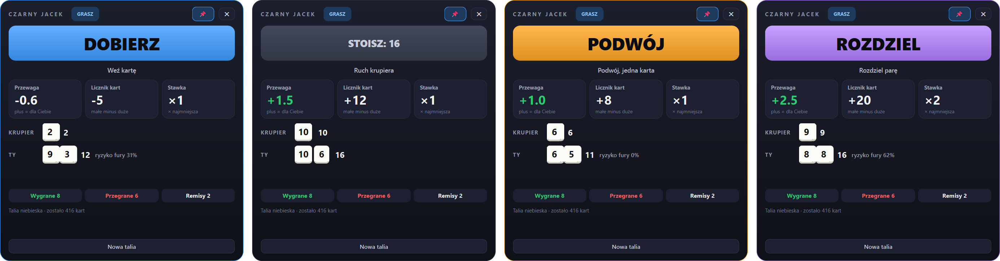
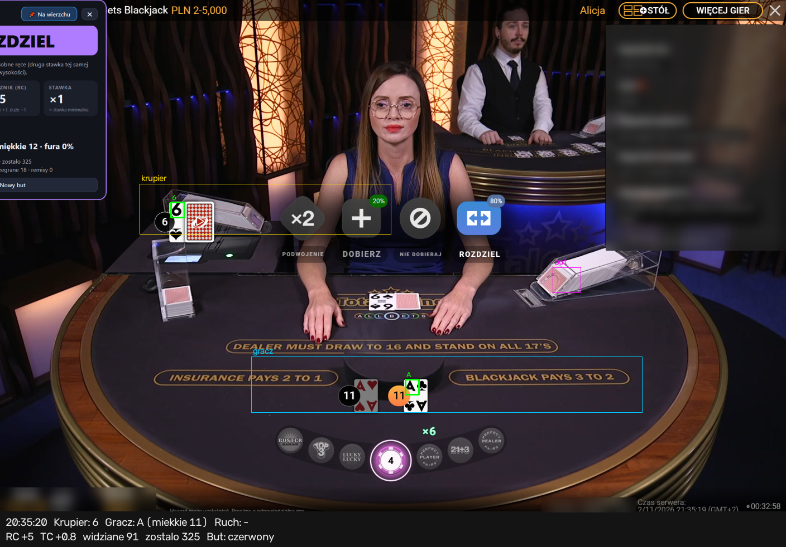
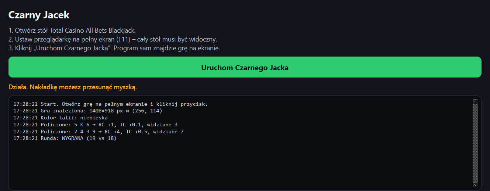

# Czarny Jacek

A Windows overlay for **Total Casino All Bets Blackjack** (live dealer, played in the browser).
It reads the cards from the screen, counts them with Hi-Lo and tells you what to do: hit, stand, double or split.



> Goal: play mathematically optimally, i.e. lose as little as possible. No system "always wins".
> With 8 decks and the shoe cut around half, the count's edge is a fraction of a percent at best.

## What it does

- **Reads the table** – finds the game anywhere on screen (template match of the top bar at any scale), then reads every card rank by template matching, including split hands.
- **Catches hidden cards** – in All Bets the game draws only your hand. Cards dealt to players still hitting after you stood are read from the dealer's felt, so the count stays complete.
- **Counts the shoe** – Hi-Lo running count, true count, cards left; detects a new shoe by the color of the card backs.
- **Advises the move** – basic strategy for 8 decks, dealer stands on soft 17, double after split, plus the Illustrious 18 count deviations. Shows bust risk for your hand and whether to take insurance.
- **Sizes the bet** – suggests 1–8 betting units from the true count.
- **Keeps score** – wins, losses and pushes of the session, played exactly as advised.
- **Records sessions** – every table change is saved to `captures/` (raw and annotated) with a log, to re-test the card reading.

The overlay is hidden from screen capture, so it never confuses its own reading.

## Screenshots

**What the program sees** – detected cards (green), dealer and player zones, the shoe, and its reading at the bottom:



**Control panel** – start button and a live log (keep it on a second monitor):



## Run

Requires Windows and Python 3.14.

```
python -m venv .venv
.venv\Scripts\pip install -r requirements.txt
.venv\Scripts\python -m czarny_jacek.main
```

Or double-click `uruchom.bat`.

1. Open the All Bets Blackjack table and make the browser full screen (F11).
2. Click **Uruchom Czarnego Jacka**. The program finds the game and opens the overlay.
3. Drag the overlay next to the table. Click **Nowa talia** if the shoe swap was missed.

Joining mid-shoe is fine: earlier cards act like burn cards, only the true count is understated until the next shoe.

## Build a single .exe

```
.venv\Scripts\pip install pyinstaller
.venv\Scripts\pyinstaller --noconfirm --onefile --windowed --name CzarnyJacek --paths . --add-data "templates;templates" czarny_jacek/main.py
```

Result: `dist/CzarnyJacek.exe` (~100 MB, no Python needed).

## Checks

```
.venv\Scripts\python -m czarny_jacek.strategy
.venv\Scripts\python -m czarny_jacek.shoe
.venv\Scripts\python -m tests.test_samples
```

`tests.test_samples` needs the private screenshots in `samples/`, which are not in the repo (they contain the casino session id).

## Project layout

| Path | Contents |
|---|---|
| `czarny_jacek/` | vision (card reading), calibration (finds the game), shoe (count), strategy, main (control panel + overlay) |
| `templates/` | digital rank glyphs, rectified felt cards, top-bar anchor |
| `tests/` | checks against the sample screenshots |
| `docs/screenshots/` | images for this README |
| `plan.md` | design notes, game facts and status |

## Disclaimer

Using assistance software may break the casino's terms and get the account closed. Gambling can be addictive. Use at your own risk.
